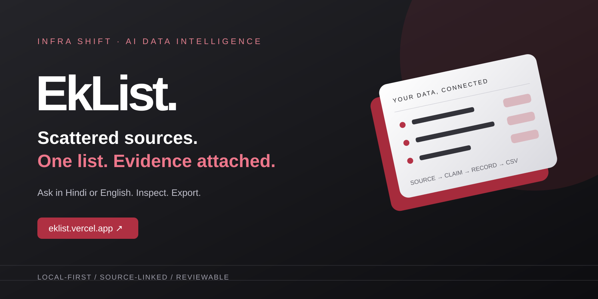
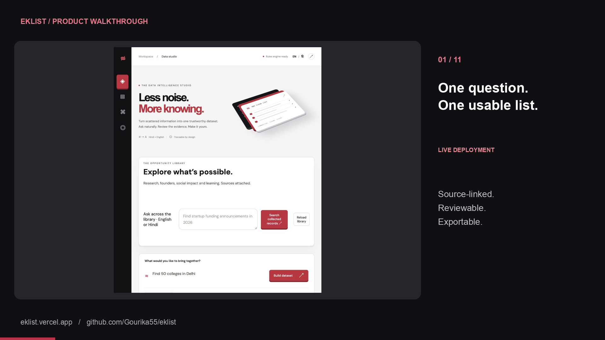
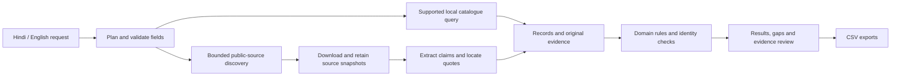

# EkList · Evidence-backed opportunity intelligence

**[Open the live workspace](https://eklist.vercel.app)** · **[API service](https://eklist-api.onrender.com)** · **[Service health](https://eklist-api.onrender.com/healthz)** · **[Demo guide](docs/DEMO.md)**

> A useful list needs more than names. It needs sources, eligibility, dates, identity checks and a clear explanation of what is still unknown.

EkList helps **students discover opportunities** and helps **placement teams, campus coordinators and NGO programme teams** build reviewable outreach and research lists. Jobs are one part of the workspace: research, scholarships, volunteering, startup programmes and education organisations belong here too.

### From a question to a usable CSV

1. **Ask** in English or Hindi: “Find 50 colleges in Delhi.”
2. **Retrieve** from the local catalogue or bounded public-source discovery.
3. **Inspect** original records, supported claims, matching decisions and missing fields.
4. **Export** a CSV with source evidence for the next step in your workflow.

Public catalogue search and public data-pack browsing/export require no sign-in. Provider-powered research, uploads and saved histories retain operator access. Anonymous catalogue queries use deterministic local rules. The backend homepage is a service landing page; use the frontend for the product.

EkList is a local-first data and lead research workspace. Ask in English or Hindi, search an imported institution catalogue, assemble public-source research, reconcile uploaded tables, and export CSVs with their evidence.

Built for **INFRA SHIFT · PS1: AI-Powered Data Intelligence Platform**. The interface combines a black-and-white workspace, crimson accents, and lightweight CSS 3D cards.

**A lead can be an institution, organisation, opportunity, or research candidate.** Different workflows have different guarantees: general research produces evidence-linked candidates; jobs and hackathons additionally apply explicit qualification rules.

## What you can do

| Workflow | Inputs | Result |
|---|---|---|
| Institution search | Hindi/English request + imported workbooks | Filtered catalogue, original records, CSV |
| Public research | Research objective | Downloaded public sources, entities, claims, evidence, gaps, CSV |
| Remote jobs | India-based eligibility and supported conditions | Qualified / needs verification / excluded listings |
| Hackathons | Supported country, mode, age and deadline conditions | Rule outcomes, cited fields, separate registration and event dates |
| Opportunity library | Seven clusters + downloaded public source packs | Filterable source-linked records, graph and evidence CSV |
| General import | CSV/XLSX + column mapping | Reconciled working list and source records |
| Subscriber review | CSV containing email and optional profile URLs | Reviewable associations; confirmed groups retain all emails |

## Live verification

On 14 November 2026, the deployed frontend and backend completed catalogue queries in English and Hindi, source inspection, library filtering and graph inspection, fresh jobs/hackathon/NGO research, subscriber CSV review, and general CSV import. Downloaded research and opportunity CSVs were checked separately. [Read the results and limitations](docs/LIVE-VERIFICATION.md).

Use **Presenter sign-in** once for provider-powered workflows and uploads. The session uses the existing deployment credentials; credentials are never included in this repository. Public catalogue and library browsing remain available without sign-in.

[Open the continuous screen recorder](https://eklist.vercel.app/record.html) to record an actual query-to-export session. Recordings stay in the browser until downloaded; do not reload before saving.

## Watch the walkthrough

[](https://github.com/Gourika55/eklist/raw/refs/heads/main/docs/assets/EkList-walkthrough.mp4)

**3 minutes 21 seconds · 1080p · narrated edited screen walkthrough.** Captured live catalogue screens are combined with clearly labelled local-development and historical examples. This is not an uninterrupted recording of every live workflow. [Download the MP4](docs/assets/EkList-walkthrough.mp4).

## Explore the demo

| Show this | What it demonstrates |
|---|---|
| “Find 50 colleges in Delhi” | Local retrieval from the institution index, exact identifiers and original rows |
| Switch Hindi / English | Bilingual interface and query entry; names and source quotations stay verbatim |
| Open a record | Trace a merged institution back to its individual source records |
| Explore opportunity clusters | Research, NGOs, funding, founders, scholarships, education and events |
| Open evidence / graph | See the source relationship and the quote behind a candidate claim |
| Export CSV | Take the reviewed list and its evidence out of the dashboard |
| Import CSV / XLSX | Map your own columns and reconcile a working list |
| Jobs / hackathon query | Separate qualified listings from missing evidence and excluded results |

**Development snapshot, 14 November 2026:** 74,847 institution rows / 73,401 distinct AISHE identifiers; 80 source-scoped opportunity-library candidates across seven clusters. Of these, 41 candidates came from the supplied local public-source packs. The hosted opportunity library was verified at 80 records on 14 November 2026. These are source-scoped candidates, not 80 certified or currently open opportunities. The bundled public seed restores the library on a fresh hosted start.

## Deploy the full stack

Use **Vercel for the frontend/API bridge and Render for the Python backend**. [Follow the complete deployment guide](docs/DEPLOYMENT.md), including the catalogue seed and server-side provider configuration. Free Render restores the catalogue on cold start but does not preserve research history across restarts. This is separate from the local quick start below.

## Quick start

Requires **Python 3.11+** and a modern browser. **Node 18+** runs JavaScript tests. The Python server uses standard-library modules; no pip installation is needed. Install Poppler's `pdftotext` separately if you want text-based PDF extraction.

```sh
git clone https://github.com/Gourika55/eklist.git
cd eklist
cp .env.example .env
python3 server.py
```

Open **http://localhost:4174**. Keep the terminal running. The server binds to loopback; this is a local prototype, not a ready-to-deploy shared service.

### Configure providers

Edit `.env` locally:

| Variable | Purpose |
|---|---|
| `NVIDIA_API_KEY` | Natural-language planning and public-source extraction |
| `EKLIST_MODEL` | Default: `nvidia/nemotron-3.5-super-vl-120b-a12b` |
| `EKLIST_API_BASE` | Default: `https://integrate.api.nvidia.com/v1` |
| `SERPER_API_KEY` | Bounded public-source discovery |
| `PORT` | Default: `4174` |
| `EKLIST_PRIVATE_CONTACTS_PATH` | Optional local contact CSV; otherwise use upload |

Never put keys in frontend files or commit `.env`. Local rules-based catalogue queries can run without provider keys once the catalogue is imported. Public research and AI planning require the corresponding services; configuring a model name does not guarantee provider availability.

### Populate the institution catalogue

**The GitHub repository does not contain the local database or source workbooks.** Download the source workbooks yourself and place these filenames in your Downloads folder:

```text
College-ALL COLLEGE.xlsx
University-ALL UNIVERSITIES.xlsx
Standalone-ALL STANDALONE.xlsx
R & D Institutes.xlsx
vidya_lakshmiAll.xlsx
```

Then run:

```sh
python3 ingest.py
```

This rebuilds `data/eklist.sqlite`; it replaces the generated catalogue. The importer expects the supplied workbook layout, including its header rows. Generic files belong in the UI's **Import CSV / XLSX** workflow instead.

The development dataset contained **74,847 source rows and 73,401 distinct AISHE identifiers**. These are measurements of that local import, not rows bundled with this repository or a promise of complete/current national coverage. The importer retains filenames, source rows, original values and file hashes. It does not invent missing publisher URLs.

## How intelligence works



- **Models propose structure.** NVIDIA interprets requests and extracts public-source claims. Code validates supported filters and output structure.
- **Sources supply records.** SQLite supplies catalogue records; public downloads supply research text. The model is not the institution database.
- **Matching uses explicit evidence.** Exact AISHE identifiers link catalogue rows. Similar names alone do not prove identity. Subscriber profile associations still require review.
- **Qualification uses rules.** Opportunity checks produce PASS, FAIL, UNKNOWN or CONFLICT. Missing evidence stays unknown rather than becoming a positive result.
- **Quotes establish provenance, not truth.** An exact quote can still be misinterpreted, outdated or incomplete. Research claims remain unreviewed.

## Sources, freshness and search budgets

| Path | Source policy |
|---|---|
| Catalogue | User-provided institution workbooks; local queries first |
| Catalogue search fallback | Explicit user action; one bounded Serper search |
| Public research | Supported catalogue retrieval where possible; otherwise up to two searches and six downloads |
| Jobs | Remotive active-jobs API; six-hour cache; publisher reports a 24-hour feed delay |
| Hackathons | Organiser URLs in `config/lead-sources.json`, targeted Serper discovery and Hack Club fallback |

The hackathon registry contains discovery URLs, not prefilled listing facts. Eligibility and deadlines must come from retrieved pages. Source coverage is bounded and changes over time; an old successful demo does not prove registration remains open.

Research downloads support public HTML, text, CSV, first-sheet XLSX and text-based PDFs. Limits include 3 MB per source and bounded extracted text. No OCR, login bypass or exhaustive crawling is implemented. Source gaps and parsing failures are retained.

Source references: [Remotive API](https://github.com/remotive-com/remote-jobs-api), [Hack Club directory](https://github.com/hackclub/hackathons). Check each publisher's reuse terms before redistributing downloaded data.

## Evidence and exports

General research exposes `results`, `entities`, `claims`, `evidence`, `sources` and `gaps` CSVs. Jobs/hackathons expose `qualified`, `needs_verification`, `excluded`, `all`, `evidence`, `duplicates` and `gaps` exports.

A qualified opportunity means the supported requested checks passed on published fields. It does not certify the organiser, employer, admission decision or acceptance. Registration deadlines are kept separate from submission deadlines and event dates.

Subscriber exports preserve all emails in confirmed groups. **EkList does not infer an active inbox or permission to contact someone from their name, role or profile.**

## Project map

```text
dist/                 Browser UI, reconciliation logic, crimson 3D theme
server.py             HTTP server, hosted landing page and protected API routes
packs.py              Hash-verified local packs, cluster filtering and evidence exports
catalog.py            Validated catalogue planning and SQLite queries
ingest.py             Institution workbook importer
research.py           Public downloads, claims, evidence and research jobs
opportunities.py      Job/hackathon connectors and qualification rules
subscribers.py        CSV mapping and profile-association candidates
config/               Public-source discovery registry
scripts/              Source collection and benchmark utilities
tests/                Python and JavaScript checks
examples/             Fictional subscriber CSV
docs/                 Demo guide and detailed implementation reference
data/                 Generated local state; excluded from Git
```

## Add downloaded data without committing it

```sh
python3 scripts/import-local-packs.py /path/to/manifest.json --root /path/to/eklist --audit-only
python3 scripts/import-local-packs.py /path/to/manifest.json --root /path/to/eklist
python3 scripts/refresh-packs.py
```

The importer verifies file hashes before extraction, keeps original retrieval dates and rejects unsupported quotations. No Git staging is required. A snapshot that contains only a portal shell does not count as a directory. Extraction is bounded, so the library is not an exhaustive mirror of source websites. See [pack ingestion and limitations](docs/OPPORTUNITY_PACKS.md).

## Test and evaluate

```sh
python3 -m unittest discover -s tests -p 'test_*.py'
npm test
```

**Latest local validation:** 60 Python tests passed with national-catalogue integration enabled, plus 14 JavaScript tests. The pack API exported 80 rows with source URLs, hashes and identity quotations. Test counts measure software checks, not factual accuracy.

Portable tests use fixtures and do not need API keys. National-catalogue integration tests are explicitly skipped unless enabled after importing the development workbooks:

```sh
EKLIST_CATALOG_INTEGRATION=1 python3 -m unittest discover -s tests -p 'test_*.py'
python3 scripts/benchmark.py
```

The benchmark uses identifier-derived labels, not independent human labels. Its precision/recall must not be advertised as overall real-world accuracy. Completeness and source coverage are separate measurements. Live-provider checks are manual and can incur API usage.

## Demo and technical details

- [Five-minute demonstration and fallback plan](docs/DEMO.md)
- [Detailed workflows, API examples, measurements and limitations](docs/technical-reference.md)

## Privacy and deployment boundaries

Credentials, private contacts, downloaded snapshots, local databases and workspace reports are excluded from the public code distribution. Uploaded contacts are not sent to NVIDIA or Serper. Public research sends public queries and downloaded excerpts to configured providers.

Hosted mode uses a server-side backend token; the Vercel bridge supports a demo sign-in. Production multi-tenant access isolation, rate limits, operational monitoring and retention controls still need further work. Persistent subscriber decisions, exhaustive cross-source entity resolution, arbitrary eligibility verification and independent factual certification are not implemented.

## Engineering attribution

This implementation was developed with Codex. The user supplied public-source packs collected through ML.ai; their manifests were hash-checked and usable snapshots were imported. ML.ai is a development agent, while NVIDIA provides runtime language-model calls. This does not imply ML.ai created every component of this repository. NVIDIA is the configured runtime model provider; Serper supplies search discovery.
