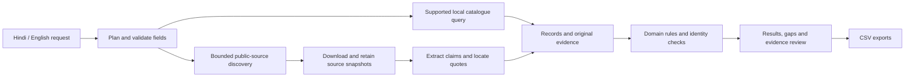

# EkList

### Scattered sources. One list. Evidence attached.

EkList is a local-first data and lead research workspace. Ask in English or Hindi, search an imported institution catalogue, assemble public-source research, reconcile uploaded tables, and export CSVs with their evidence.

Built for **INFRA SHIFT · PS1: AI-Powered Data Intelligence Platform**. The interface combines a black-and-white workspace, crimson accents, and lightweight CSS 3D cards.

**A lead can be an institution, organisation, opportunity, or research candidate.** Different workflows have different guarantees: general research produces evidence-linked candidates; jobs and hackathons additionally apply explicit qualification rules.

## What you can do

| Workflow | Inputs | Result |
|---|---|---|
| Institution search | Hindi/English request + imported workbooks | Filtered catalogue, original records, CSV |
| Public research | Research objective | Downloaded public sources, entities, claims, evidence, gaps, CSV |
| Remote jobs | India-based eligibility and supported conditions | Qualified / needs verification / excluded listings |
| Hackathons | Supported country, mode, age and deadline conditions | Rule outcomes, cited fields, separate registration and event dates |
| General import | CSV/XLSX + column mapping | Reconciled working list and source records |
| Subscriber review | CSV containing email and optional profile URLs | Reviewable associations; confirmed groups retain all emails |

## Deploy the full stack

Use **Vercel for the frontend/API bridge and Render for the Python backend**. [Follow the complete deployment guide](docs/DEPLOYMENT.md), including the catalogue seed and server-side provider configuration. Free Render restores the catalogue on cold start but does not preserve research history across restarts. This is separate from the local quick start below.

## Quick start

Requires **Python 3.11+** and a modern browser. **Node 18+** runs JavaScript tests. The Python server uses standard-library modules; no pip installation is needed. Install Poppler's `pdftotext` separately if you want text-based PDF extraction.

```sh
git clone https://github.com/Gourika55/eklist.git
cd eklist
cp .env.example .env
python3 server.py
```

Open **http://localhost:4174**. Keep the terminal running. The server binds to loopback; this is a local prototype, not a ready-to-deploy shared service.

### Configure providers

Edit `.env` locally:

| Variable | Purpose |
|---|---|
| `NVIDIA_API_KEY` | Natural-language planning and public-source extraction |
| `EKLIST_MODEL` | Default: `nvidia/nemotron-3.5-super-vl-120b-a12b` |
| `EKLIST_API_BASE` | Default: `https://integrate.api.nvidia.com/v1` |
| `SERPER_API_KEY` | Bounded public-source discovery |
| `PORT` | Default: `4174` |
| `EKLIST_PRIVATE_CONTACTS_PATH` | Optional local contact CSV; otherwise use upload |

Never put keys in frontend files or commit `.env`. Local rules-based catalogue queries can run without provider keys once the catalogue is imported. Public research and AI planning require the corresponding services; configuring a model name does not guarantee provider availability.

### Populate the institution catalogue

**The GitHub repository does not contain the local database or source workbooks.** Download the source workbooks yourself and place these filenames in your Downloads folder:

```text
College-ALL COLLEGE.xlsx
University-ALL UNIVERSITIES.xlsx
Standalone-ALL STANDALONE.xlsx
R & D Institutes.xlsx
vidya_lakshmiAll.xlsx
```

Then run:

```sh
python3 ingest.py
```

This rebuilds `data/eklist.sqlite`; it replaces the generated catalogue. The importer expects the supplied workbook layout, including its header rows. Generic files belong in the UI's **Import CSV / XLSX** workflow instead.

The development dataset contained **74,847 source rows and 73,401 distinct AISHE identifiers**. These are measurements of that local import, not rows bundled with this repository or a promise of complete/current national coverage. The importer retains filenames, source rows, original values and file hashes. It does not invent missing publisher URLs.

## How intelligence works



- **Models propose structure.** NVIDIA interprets requests and extracts public-source claims. Code validates supported filters and output structure.
- **Sources supply records.** SQLite supplies catalogue records; public downloads supply research text. The model is not the institution database.
- **Matching uses explicit evidence.** Exact AISHE identifiers link catalogue rows. Similar names alone do not prove identity. Subscriber profile associations still require review.
- **Qualification uses rules.** Opportunity checks produce PASS, FAIL, UNKNOWN or CONFLICT. Missing evidence stays unknown rather than becoming a positive result.
- **Quotes establish provenance, not truth.** An exact quote can still be misinterpreted, outdated or incomplete. Research claims remain unreviewed.

## Sources, freshness and search budgets

| Path | Source policy |
|---|---|
| Catalogue | User-provided institution workbooks; local queries first |
| Catalogue search fallback | Explicit user action; one bounded Serper search |
| Public research | Supported catalogue retrieval where possible; otherwise up to two searches and six downloads |
| Jobs | Remotive active-jobs API; six-hour cache; publisher reports a 24-hour feed delay |
| Hackathons | Organiser URLs in `config/lead-sources.json`, targeted Serper discovery and Hack Club fallback |

The hackathon registry contains discovery URLs, not prefilled listing facts. Eligibility and deadlines must come from retrieved pages. Source coverage is bounded and changes over time; an old successful demo does not prove registration remains open.

Research downloads support public HTML, text, CSV, first-sheet XLSX and text-based PDFs. Limits include 3 MB per source and bounded extracted text. No OCR, login bypass or exhaustive crawling is implemented. Source gaps and parsing failures are retained.

Source references: [Remotive API](https://github.com/remotive-com/remote-jobs-api), [Hack Club directory](https://github.com/hackclub/hackathons). Check each publisher's reuse terms before redistributing downloaded data.

## Evidence and exports

General research exposes `results`, `entities`, `claims`, `evidence`, `sources` and `gaps` CSVs. Jobs/hackathons expose `qualified`, `needs_verification`, `excluded`, `all`, `evidence`, `duplicates` and `gaps` exports.

A qualified opportunity means the supported requested checks passed on published fields. It does not certify the organiser, employer, admission decision or acceptance. Registration deadlines are kept separate from submission deadlines and event dates.

Subscriber exports preserve all emails in confirmed groups. **EkList does not infer an active inbox or permission to contact someone from their name, role or profile.**

## Project map

```text
dist/                 Browser UI, reconciliation logic, crimson 3D theme
server.py             Local HTTP server and API routes
catalog.py            Validated catalogue planning and SQLite queries
ingest.py             Institution workbook importer
research.py           Public downloads, claims, evidence and research jobs
opportunities.py      Job/hackathon connectors and qualification rules
subscribers.py        CSV mapping and profile-association candidates
config/               Public-source discovery registry
scripts/              Source collection and benchmark utilities
tests/                Python and JavaScript checks
examples/             Fictional subscriber CSV
docs/                 Demo guide and detailed implementation reference
data/                 Generated local state; excluded from Git
```

## Test and evaluate

```sh
python3 -m unittest discover -s tests -p 'test_*.py'
npm test
```

Portable tests use fixtures and do not need API keys. National-catalogue integration tests are explicitly skipped unless enabled after importing the development workbooks:

```sh
EKLIST_CATALOG_INTEGRATION=1 python3 -m unittest discover -s tests -p 'test_*.py'
python3 scripts/benchmark.py
```

The benchmark uses identifier-derived labels, not independent human labels. Its precision/recall must not be advertised as overall real-world accuracy. Completeness and source coverage are separate measurements. Live-provider checks are manual and can incur API usage.

## Demo and technical details

- [Five-minute demonstration and fallback plan](docs/DEMO.md)
- [Detailed workflows, API examples, measurements and limitations](docs/technical-reference.md)

## Privacy and deployment boundaries

Credentials, private contacts, downloaded snapshots, local databases and workspace reports are excluded from the public code distribution. Uploaded contacts are not sent to NVIDIA or Serper. Public research sends public queries and downloaded excerpts to configured providers.

Before a shared deployment, add authentication, access isolation, rate limits, operational monitoring and appropriate data-retention controls. Persistent subscriber decisions, exhaustive cross-source entity resolution, arbitrary eligibility verification and independent factual certification are not implemented.

## Engineering attribution

This implementation was developed with Codex. ML.ai is an intended development tool for further ingestion, testing and maintenance work; this repository does not claim unperformed ML.ai contributions. NVIDIA is the configured runtime model provider; Serper supplies search discovery.
